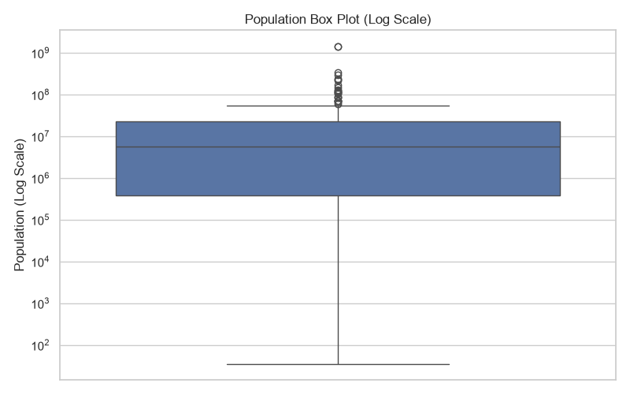
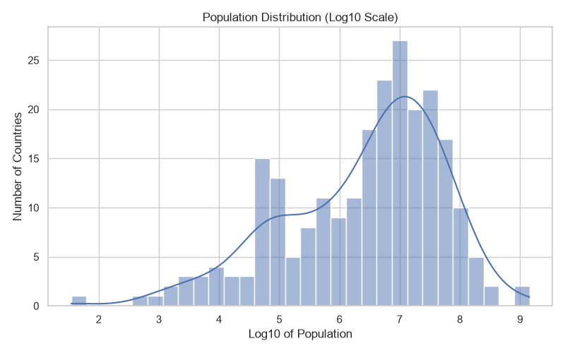
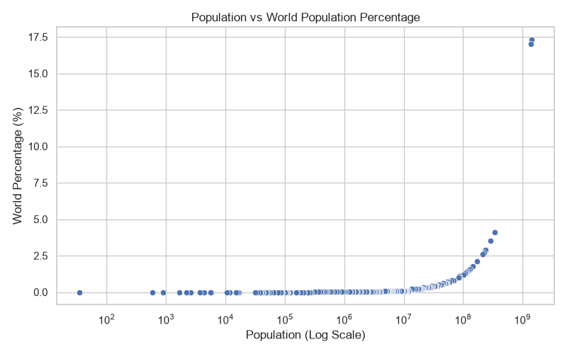
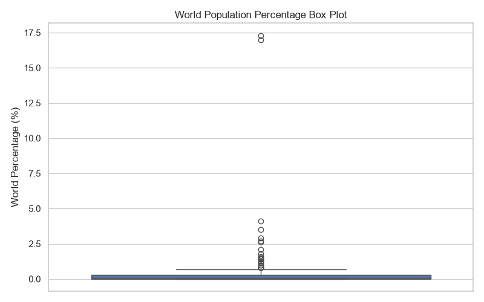
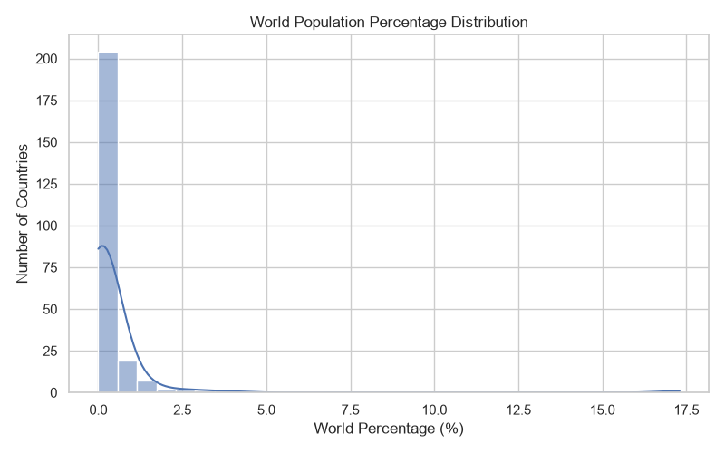
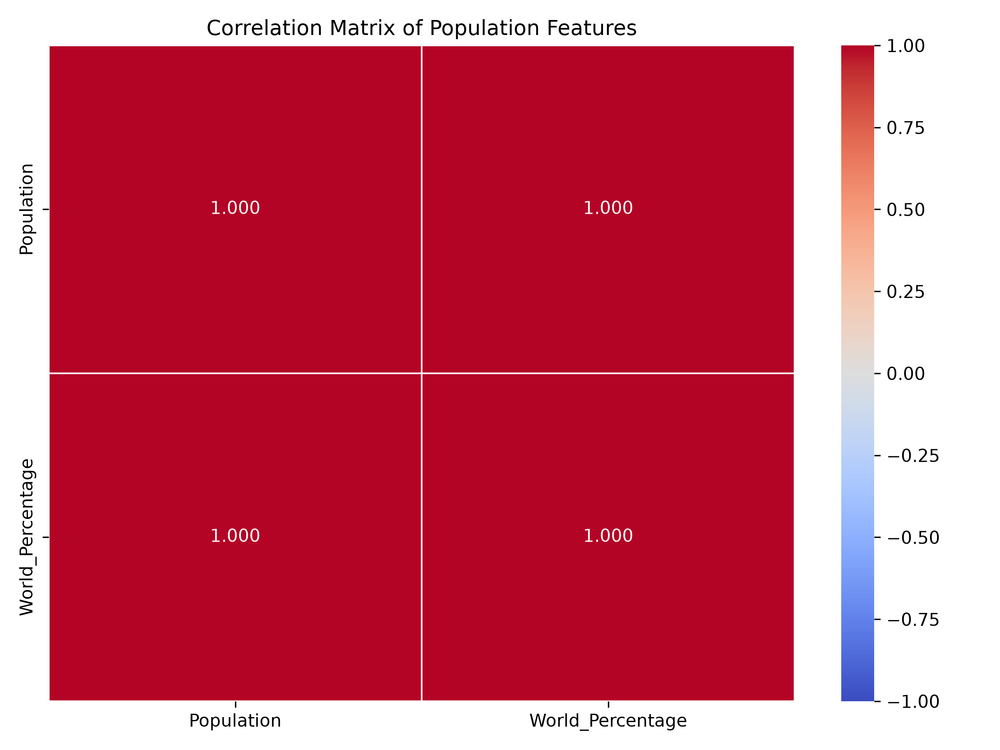

# Exploratory Data Analysis (EDA) Report

**Codveda Technology – Data Science Internship**  
**Level 1 (Basic), Task 3 – Exploratory Data Analysis**

## 1. Project overview

This report explores the country-population dataset produced by Task 1 and preprocessed in Task 2. The analysis uses the original `Population` and `World_Percentage` measurements from the Task 2 output. Standardized versions are not used for the descriptive statistics or Pearson correlation.

- Records analysed: **239**
- Columns in the input file: **12**
- Input file: `preprocessed_country_population.csv`
- Numerical variables analysed: `Population`, `World_Percentage`

## 2. Summary statistics

| Variable | Count | Mean | Median | Variance | Std. deviation | Minimum | Maximum |
|---|---:|---:|---:|---:|---:|---:|---:|
| Population | 239 | 33,788,627.5858 | 5,557,096.0000 | 18,294,875,734,894,980.0000 | 135,258,551.4298 | 35.0000 | 1,429,404,000.0000 |
| World_Percentage | 239 | 0.4036 | 0.0700 | 2.6795 | 1.6369 | 0.0000 | 17.3000 |

### Interpretation

The mean population is **33,788,627.59**, while the median is **5,557,096**. The mean being substantially higher than the median indicates a right-skewed population distribution: a relatively small number of highly populated countries raise the average.

The mean world-population share is **0.4036%**, and the median is **0.0700%**. This also indicates that most countries account for a small share, while a few account for much larger shares.

## 3. Visual analysis

### Population Box Plot (Log Scale)



Shows the median, interquartile range, whiskers and high-population outliers. The logarithmic y-axis makes the wide range of country populations easier to view.

### Population Distribution Histogram (Log10 Scale)



Shows the frequency distribution of log10-transformed population values. The largest concentration is around a log10 population value of 7.

### Population vs World Population Percentage



Shows the positive association between population and world-population share. The population axis is logarithmic.

### World Population Percentage Box Plot



Shows that most countries have small world-population shares, while a small number of countries have much larger shares.

### World Population Percentage Distribution



Shows a strongly right-skewed distribution, with most observations near zero and a small number of much larger percentages.

### Correlation Heatmap



Visualizes the Pearson correlation between Population and World_Percentage.

## 4. Correlation analysis

| Variable | Population | World_Percentage |
|---|---:|---:|
| Population | 1.000000 | 0.999929 |
| World_Percentage | 0.999929 | 1.000000 |

The Pearson correlation coefficient between Population and World_Percentage is **0.999929**, which indicates an extremely strong positive linear association in this dataset. This is expected because a country's world-population percentage is calculated from its population relative to the world total. The correlation is therefore not evidence that one variable causes the other.

## 5. IQR outlier review

| Variable | Number of IQR outliers |
|---|---:|
| Population | 25 |
| World_Percentage | 24 |

The IQR method flags observations outside 1.5 × IQR from the first and third quartiles. These flags identify statistically unusual values, not automatically incorrect records. The high values correspond to real countries with large populations and population shares, so they are retained in this descriptive analysis.

## 6. Key findings

1. Country populations vary substantially across the 239 records.
2. Population and world-population share distributions are right-skewed.
3. The box plots identify a number of high-value IQR outliers; these are treated as valid observations.
4. The scatter plot and correlation matrix show an extremely strong positive association between population and world-population share.
5. Logarithmic population axes make the wide range of country population values easier to examine.

## 7. Conclusion

The EDA shows that population is unevenly distributed across countries: most countries have comparatively small populations and world-population shares, while a small number have very large values. Population and world-population share move together closely because the percentage is derived from population. The visualizations and statistics provide a clear descriptive overview of the dataset.

## 8. Reproducibility

Run the following scripts from the `TASK_3_EDA` directory:

```bash
python summary_statistics.py
python data_visualization.py
python correlation_analysis.py
python generate_eda_report.py
```

The report uses the chart PNG files generated by `data_visualization.py` and `correlation_analysis.py`. Keep the report and chart images in the same directory so the embedded figures display correctly.
